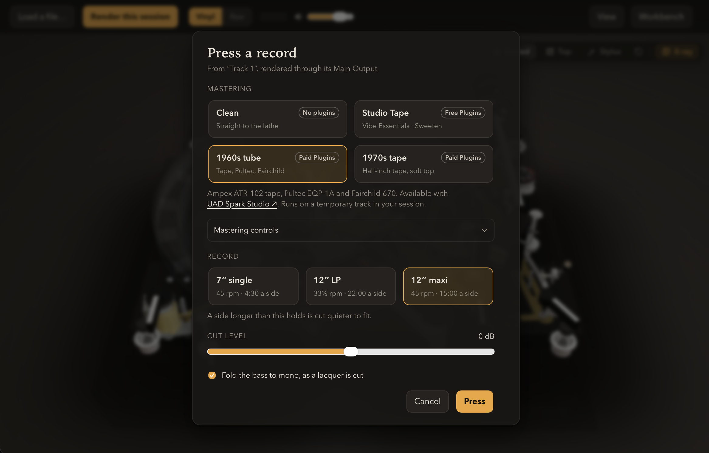
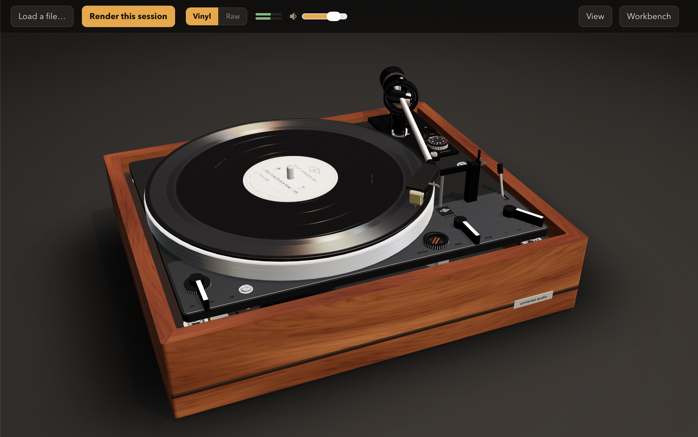
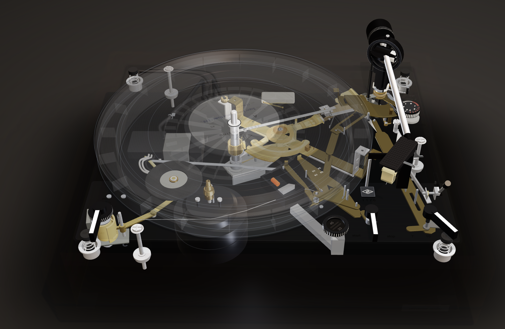
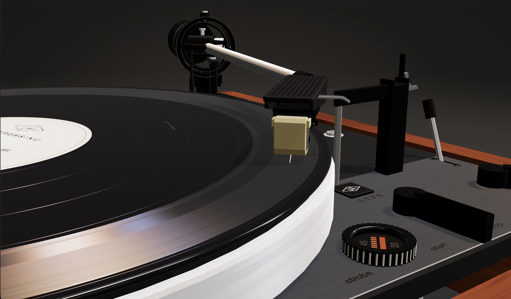

# Listening Booth

## The groove is the recording.

Listening Booth lets you press a virtual record from your LUNA session or an audio file. The cutter turns your mix into the shape of a vinyl groove. Drop the needle and the simulated stylus traces that groove as the platter spins. Its motion produces the sound you hear.

**Master for the cut.** Press your mix clean or choose Studio Tape, 1960s Tube, or 1970s Tape. The mastering presets use UAD plug-ins to shape the mix before it reaches the cutter. Some presets require licensed plug-ins.

**Hear what changed.** Switch between **Vinyl** and **Raw** at the same point in the song. Listen to the original mix, then hear what the mastering, cut, and playback do to that same passage.

**Look under the platter.** Tracking force and anti-skate affect how the stylus follows the groove. Turn on **X-Ray** to watch the idler drive, cam, and tonearm linkages work as you operate the deck.

## Install

Download the `.lunaaddon` file from the latest [release](https://github.com/shawnist/listening-booth/releases/latest) and double-click
it; LUNA asks to add it. Open it from **Add Ons > Windows > Listening Booth**.

## Requirements

- LUNA 3.1.1 or later, on **macOS**. It does not run in LUNA on Windows yet.
- Imported WAV, MP3, AIFF, FLAC, and M4A files press clean. Use a LUNA session to apply the mastering presets.
- Studio Tape uses the factory Sweeten preset in Vibe Analog Machines Essentials from UAD Explore FREE.
- 1960s Tube and 1970s Tape both use Ampex ATR-102 and Pultec EQP-1A. 1960s Tube also uses Fairchild 670. These paid plug-ins are available in UAD Spark Studio. Install and authorize the plug-ins for the preset you want to use.

## What it does to your session

Rendering bounces the mix into the session's own folder, next to its `.luna` package. A mastered
cut also adds a temporary track named "Listening Booth cut", masters the mix on it,
bounces a second file and deletes the track; the imported audio stays in the session's audio pool
and the steps show in LUNA's undo history. Audio processing takes place on your Mac.

## Licences

Includes the [LUNA Builder SDK](https://github.com/uaudio-labs/luna-builder-sdk) (`addons/luna/vendor/LICENSE` and `NOTICE`) and [three.js](https://threejs.org) (MIT licence, `vendor/three/LICENSE`).
